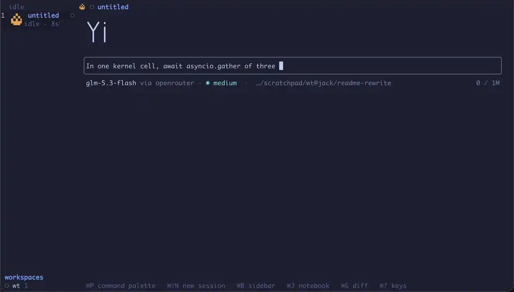

# Yi

A coding agent in one Rust binary. The model works inside a persistent Python kernel, where
subagents are function calls and plans are programs.




## Install

```bash
curl -fsSL https://raw.githubusercontent.com/jackmaxwil/yi/main/scripts/install.sh | bash
yi --version
```

It checks the release's sha256 and the owner's key, then installs `yi` to `~/.local/bin` and its
runtime to `~/.yi`; Apple-silicon Macs and x86_64 Linux, and `| bash -s -- --help` prints that key. By hand:

```bash
v=X.Y.Z t=aarch64-apple-darwin; base=https://github.com/jackmaxwil/yi/releases/download/v$v; a=yi-$v-$t.tar.gz
curl -fLO "$base/$a" -O "$base/$a.sig" -O "$base/SHA256SUMS"; shasum -a 256 -c SHA256SUMS --ignore-missing
echo 'jackmaxwil-release ssh-ed25519 AAAAC3NzaC1lZDI1NTE5AAAAIAaFfxFxxkIpL0TuZcvkcLpzT164hwIaCbzyFnVkAMX7' > allowed_signers
ssh-keygen -Y verify -f allowed_signers -I jackmaxwil-release -n yi-release -s "$a.sig" < "$a"
tar -xzf "$a" && "./yi-$v-$t/install.sh"
```

## Quick start

```bash
yi ask --model faux/faux-1 "hello"   # offline, no key: prints "faux: hello"
yi                                   # the console; --solo: one chat
yi login openrouter                  # paste a key at the prompt
yi setup                             # default model and permission mode
yi "what does this repo do?"         # one answer
```

## Log in

```bash
yi login --list          # the providers you can sign in to
yi login openrouter      # an API key: paste it at the prompt, or pipe it on stdin
yi login cursor          # browser sign-in; --no-browser skips opening it
```

`openrouter`, `openai` and `google` take an API key; `cursor` signs in through the browser.
`kimi`, `anthropic` and `openai-codex` sign in with OAuth, once you copy a
[profile template](docs/examples) to `~/.yi/oauth/<provider>.json`.

Keys and tokens are saved under `~/.yi/providers/tokens/` (mode 0600), never in the config. An
`*_API_KEY` environment variable wins over a saved key.

## Plugins and skills

A plugin is an outside program that Yi downloads, checks against a pinned sha256 and keeps in
`~/.yi/plugins/<name>/<version>/`. `yi plugin list` prints this build's pinned versions and
summaries, plus what is installed or already on your `PATH`.

```bash
yi plugin list
yi plugin add --all                  # or one: ripwire, chrome
yi plugin sync
```

A skill is a directory with a `SKILL.md`. Yi reads `.yi/skills`, `.agents/skills`, `.pi/skills` and
`.claude/skills` in the repository, then `~/.yi/skills`; the first skill with a name wins. Type
`$name` in a message to point the model at one.

```markdown
---
name: release
description: Cut a release of this repo
---
Run `just release`, then check the tag on the forge.
```

## Configure

```bash
yi debug config                       # ~/.yi/config.json, secrets redacted
```

`~/.yi/config.json` is the one config file. Strict: an unknown key is an error that names it.
Every key is in [YI_DESIGN.md §17.1](docs/YI_DESIGN.md).

| key | default | meaning |
|---|---|---|
| `model`, `thinking` | none, `medium` | `provider/id`; `off` to `max` effort |
| `models.summarizer`, `.advisor`, `.autoReview` | main, off, off | compaction, titles; naming one turns it on |
| `models.classifier` | off | TypeSafe's Jev through OpenRouter (`typesafe/jev-1.13`) as the permission and skill classifier; typed messages and judged commands leave the machine |
| `routing` | none | OpenRouter's `provider` object |
| `permissions.mode`, `permissions.allow` | `auto`, none | `ask`, `auto` or `yolo`; calls that run unasked |
| `tui.pace` | 100 | reveal speed, percent |
| `rlm.maxDepth` | 1 | subagent nesting, 1 to 3 |
| `kernel.prewarm`, `mcp.enabled`, `lanes.enabled` | true, false, true | kernel at open; the MCP CLI; a worktree per root |

| environment | for |
|---|---|
| `YI_PREFIX`, `YI_VERSION`, `YI_RELEASE_BASE` | install directory; the release it reads |
| `YI_KERNEL_VENV`, `YI_KERNEL_PYTHON`, `YI_BIN` | the kernel's venv; the `yi` it calls |
| `YI_TRACE`, `YI_CLAUDE_HOOKS`, `YI_CLAUDE_HOOKS_FILES` | a profiler trace; Claude Code tool hooks |
| `YI_LEVERS`, `YI_FIXED_IDS`, `YI_BLESS`, `YI_FAKE_RIPWIRE`, `YI_WARM`, `YI_REVIEW_MODEL`, `YI_ROUND_AUTHORS`, `YI_SIGNING_KEY`, `YI_ALLOWED_SIGNERS` | development: levers, ids, goldens, fakes, review bot, signing |

| verb | |
|---|---|
| `ask` `rpc` `acp` `serve` `console` `tui` | one turn; stdio protocols; daemon; workspace; solo TUI |
| `plan` `todo` `why` | plan ops; the newest todo list; a line to its goal |
| `sessions` `stats` `memory` `fetch` `catalog` | sessions; token stats; memories; one URL |
| `undo` `lanes` `trust` `gate` `doctor` `gc` `debug` | undo; worktrees; trust; policy; repair |
| `login` `logout` `setup` `plugin` `update` `version` `mcp` | credentials; plugins; release; MCP |

Flags: `--model`, `--json`, `--schema`, `--yolo`, `--continue`, `--deadline`;
`yi --help` has all.

## Architecture

The [architecture map](docs/ARCHITECTURE.md#data-flow) shows a surface handing the user's words to
the runtime, which runs model turns that call tools. The `ipython` tool runs a cell in the Python
kernel ([below](#the-kernel)), and from a cell, `rlm.ask` and `rlm.run` reach back into the runtime
to start a child session. Crate rules: [YI_DESIGN.md §2](docs/YI_DESIGN.md).

## The kernel

Yi runs a real Jupyter kernel (IPython) for each session. The model's `ipython` tool sends it
cells, and the kernel keeps its variables, imports and open plans between cells, so a later cell
can use what an earlier one built. Yi speaks the Jupyter protocol itself, over ZeroMQ with signed
messages; there is no notebook server and no browser.

The kernel's Python code (`rlm` for subagents and `fetch`, `yi` for plans) is packed inside the
`yi` binary. On first use Yi unpacks it and builds a virtual environment with [uv](https://docs.astral.sh/uv/):

- **Where:** `~/.yi/kernel-venv-<hash>`. The hash covers the packaged code, so a new Yi build
  rebuilds the venv by itself the next time a kernel starts.
- **Which uv:** the one on your `PATH` or in `~/.local/bin`, else one under `~/.yi/uv/`. With
  neither, Yi uses `python3` 3.11 or later, and failing that downloads a pinned uv and checks its sha256.
- **When:** the first `ipython` call, or at session open in the background (`kernel.prewarm`,
  on by default), so the first cell does not wait.
- **Override:** `YI_KERNEL_VENV` and `YI_KERNEL_PYTHON` point Yi at a venv or interpreter of yours.

The kernel runs inside the same Seatbelt sandbox as commands, and reaches Yi only through named
requests (`rlm.ask`, `Plan.create`, `fetch`). A cell is cut off after 600 seconds. Each running kernel holds one of a machine's slots (your cores
less one, at most 8), so a crowd of sessions waits instead of swamping the machine.
Design: [YI_DESIGN.md §9](docs/YI_DESIGN.md).

## Plans

A plan is a to-do list the agent cannot fake. A todo can wait on other todos, and can carry a
contract: a check that has to pass before the todo counts as done.

```text
goal: port the parser to the new token type

  ┌──────────┐       ┌──────────┐       ┌──────────┐
  │  lexer   │──────▶│  parser  │──────▶│  tests   │
  │   done   │       │ running  │       │ pending  │
  └──────────┘       └──────────┘       └──────────┘
  cargo build        cargo test         cargo test
  passed             -p parser          --workspace
                     must exit 0        must exit 0
```

An arrow means "after". The check under a todo is its contract: the agent says it is done, the
check runs on a copy of the tree, and only a pass closes the todo.

```text
pending ──start──▶ running ──done, check passes──▶ done
                      │   └───done, check fails──▶ refused, still running
                      │                           (the third refusal hands it to you)
                      ├────fail──▶ failed  ──retry──▶ pending
                      └───block──▶ blocked ──unblock─▶ pending
```

```python
plan = await Plan.create("port the parser to the new token type")
lexer = await plan.todo(key="lexer", label="new token type in the lexer",
                        delegate=Writer(accept=contract(cmd("cargo build", critical=True))))
parser = await plan.todo(key="parser", label="port the parser", after=["lexer"],
                         delegate=Writer(accept=contract(cmd("cargo test -p parser", critical=True))))
```

```console
$ yi todo                             # the newest todo list
$ yi why crates/cli/src/main.rs:42    # walk a line back to the words that asked for it
```

Every change to a plan is appended to a hash-chained journal in `.yi/plans/`, so a plan can be
replayed and not edited behind the agent's back. Design: [YI_DESIGN.md §13](docs/YI_DESIGN.md).

## Subagents

```python
answers = await asyncio.gather(*(rlm.ask("Can this function panic? Quote the line.", [url]) for url in urls))
h = await rlm.run("Port the parser to the new token type", role="worker", isolation="worktree")
result = await h.result(timeout=420)
```

A `reader` gets `read`, `grep` and three turns; a `worker` edits too; a `root` is a session.
`isolation="worktree"` gives a child a worktree. Design: [YI_DESIGN.md §11](docs/YI_DESIGN.md).

## Lanes

A lane is a git worktree that Yi lends to one session, so the session edits a checkout of its own
and your working directory is never touched. Open two sessions in one repository and each gets its
own lane and branch.

```bash
yi lanes                  # the repository's lanes: idle, held, or left over from a session
yi lanes reap 2           # wipe lane 2 and say how many paths that dropped
```

```text
~/.yi/lanes/<repo hash>/
    1/   ← session A, branch yi/a1b2
    2/   ← session B, branch yi/c3d4
    3/   ← idle, waiting
```

- **Claim.** Starting a session in a git repository takes a free lane, resets it to `origin/main`
  (else `main`, else `HEAD`) and checks out a branch `yi/<session>`. A branch that already holds
  commits is checked out as it stands, never reset.
- **Busy or free.** A lane is held while a process holds its lock file. A lane with uncommitted
  changes is never free, even when its session is gone; resuming a session gives it its own lane back.
- **Hand back.** `/discard` cleans the lane and deletes its branch. Otherwise the lane is
  released, and one with changes keeps its branch and waits for its session.
- **Land.** `/land <title>` merges `origin/main` into the branch, pushes, opens a pull request,
  and checks it every minute for up to two hours. It uses `gh` for a GitHub origin and `fgj` for a
  Forgejo one.
- **Opt out.** `--here` works in your own checkout. `lanes.enabled: false` turns lanes off, and a
  directory outside a repository has none.

Lanes are for root sessions. A subagent started with `isolation="worktree"` gets a copy of its
own, described next, and hands its work back through `rlm.merge_worktree` (optionally with a
`check` command that must pass) or `rlm.discard_worktree`. Design: [YI_DESIGN.md §14](docs/YI_DESIGN.md).

### Copy-on-write forks

A worktree subagent starts from a copy of your repository under `~/.yi/forks`. On a Mac the copy
is free: Yi asks APFS for a clone of each file, and a clone shares the original's disk blocks
until one side writes. Only the blocks a write touches are copied, so a fork of a large repository
takes about no extra disk and a moment of time, and the child's edits never reach your files.

```text
your checkout      fork under ~/.yi/forks
 src/parser.rs ──┐
                 ├── one set of blocks on disk      (clone: no bytes copied)
 src/parser.rs ◀─┘
        child edits parser.rs ──▶ the child gets its own copy of the changed blocks
        everything it did not touch stays shared
```

- **What the child has.** The tracked files at your `HEAD`. Uncommitted changes are left behind,
  and the child is told how many; pass them in its prompt as `local://` addresses. Ignored files
  such as `.env` are left behind too: `carry=[".env"]` on `rlm.run`, or a `.worktreeinclude` file,
  copies the ones you name.
- **Warm builds.** The child's first command that writes also clones in the cargo build units that
  do not depend on files outside the tree, so it does not start from a cold `target/`, then runs a
  committed `.yi/setup` script if there is one.
- **Elsewhere.** Linux has no clone call. There the fork is a plain git checkout, and cargo
  artifacts are hard-linked rather than cloned.

## Advisor

The advisor is a second model that watches the first. It reads a digest of the session's work and
may leave one piece of advice per review, such as "that edit does not match what you were asked".
It is off until you name a model for it, and it never edits anything.

**1. Pick a model.** A different model from your main one gives the most independent second
opinion. `yi models recommend` ranks models per role from OpenRouter's benchmarks:

```bash
yi models refresh                     # fetch the benchmark snapshot once
yi models recommend --role advisor    # high, medium and low picks
```

**2. Name it in `~/.yi/config.json`.**

```json
{
  "model": "openrouter/<main model>",
  "models": { "advisor": "openrouter/<advisor model>" }
}
```

**3. Optionally, tell it what to look for.** A file named `ADVISOR.md` in the directory you run
Yi from is added to the advisor's instructions: the conventions, risks and scope limits you want it to hold
the agent to.

```markdown
Flag any change outside `crates/parser/`. Warn on a new dependency. Hold a push to `main`.
```

How it behaves:

- **When it reviews.** When a plan changes and when the session compacts. Each review is a
  fresh session that sees a digest of the work since the last review, not the whole transcript.
- **What it can say.** One piece of advice per review, as a `note`, a `warn` or a `hold`, about a
  `correction`, `risk`, `scope` or `stop`. A note or warn arrives in the session as a message,
  between turns or in the middle of one. A `hold` makes the tool or path it names ask you before
  it runs, for an hour; with no one to ask, as in `yi ask`, it becomes a warn.
- **Keeping advice.** `/advisor` lists the advice you can keep, and `/advisor promote <id>` saves
  one as a rule in `.yi/rules/`, so it applies to every later session in the repository. Nothing
  else the advisor says is stored.

Design: [YI_DESIGN.md §16](docs/YI_DESIGN.md).

## Memory

Memory is a folder of short notes that outlive a session: one markdown file per fact, so the
next session starts knowing what the last one learned. The model reads and writes them through
kernel functions; Yi checks and writes every file itself.

```bash
yi memory list                        # the notes of this repository and your global ones
yi memory search "release"            # ranked, by name, description and body
yi memory show release-steps
yi memory forget release-steps
```

```markdown
---
name: release-steps
description: how a release of this repo is cut
type: project
---
Run `just release`, then check the tag on the forge.
```

- **Two stores.** The repository's notes live in `~/.yi/projects/<repo>/memory/` and are shared by
  every worktree and lane of that repository; your global notes live in `~/.yi/memory/`. Each holds
  a `MEMORY.md` index you can edit by hand.
- **Four types.** `user`, `feedback`, `project` and `reference`.
- **What the model sees.** At session start the index (not the notes) is added to the prompt as
  untrusted text, at most 200 lines or 25,000 bytes per store. The model reads a note when it needs
  it with `memory.read(name)` or finds one with `memory.search("words")`.
- **Limits.** Only the main session keeps memory, not its subagents. A session may save three
  notes. A save that holds a key-shaped secret, or is over its size limits, is refused with the
  reason.
- **History.** Every change is appended to a hash-chained journal in the store. `yi memory check`
  lists notes that do not parse, and `yi memory rebuild` restores the notes from the journal.
- **Past sessions.** `compact.search("words")` in a kernel cell searches what you and Yi said in
  earlier sessions in this repository, using the same ranking.

Design: [docs/memory.md](docs/memory.md).

## MCP servers

MCP is a command-line tool in Yi, not a tool the model carries. A model that held every tool
definition of every server would spend its context on them; instead it finds a tool with `grep`
and calls it from the shell or from a kernel cell. Nothing stays running: each `yi mcp` command
connects, runs and exits.

Turn it on, and name your servers in `~/.yi/mcp.json`, `.mcp.json`, `.vscode/mcp.json` or
`.cursor/mcp.json` (a `mcpServers` object, as those editors write it):

```json
{ "mcp": { "enabled": true } }
```

```bash
yi mcp connect github @gh             # connect the entry "github", and name the session @gh
yi mcp @gh tools-list
yi mcp @gh tools-call search_issues query:="panic" --json
yi mcp grep "issue"                   # find a tool across every connected server
yi mcp login https://mcp.example.com/mcp   # OAuth in the browser; tokens go to the OS keychain
```

- **Connect.** A server is an entry name, a `file:entry` pair, a config path, or a URL.
  A command-based (stdio) server starts in `~/.yi`, outside the sandbox's writable folders, so its
  command must be an absolute path or on `PATH`.
- **From a cell.** `rlm.mcp.list_tools`, `rlm.mcp.call_tool`, `rlm.mcp.reload` and `rlm.mcp.close`
  run the same commands, so the kernel never holds a socket or a token.
- **Tokens.** `mcp.tokenStore` is `keychain` or `file`.
- **Exit codes.** 0 ok, 1 a `grep` with no match, 2 bad usage, 3 the server failed.

`yi mcp help --skill` prints the guide Yi gives the model. Design: [YI_DESIGN.md §7.6](docs/YI_DESIGN.md).

## Claude Code compatibility (experimental)

Yi reads some of what Claude Code writes, so work you already did there carries over. These
parts are experimental: they cover what is listed and skip the rest with a notice.

**Memories.** Yi's notes are the same shape as Claude Code's: markdown with `name`, `description`
and `type` in the frontmatter (Claude's `metadata: type:` form is read too), plus a `MEMORY.md`
index. Copy a Claude project's notes into this repository's store:

```bash
yi memory import ~/.claude/projects/<project>/memory
```

It skips identical files, merges the index lines and keeps any frontmatter keys Yi does not know.
Yi also reads `CLAUDE.md` beside `AGENTS.md`, and skills from `.claude/skills`.

**Hooks.** Set `YI_CLAUDE_HOOKS=1` and Yi runs the `PreToolUse`, `PostToolUse` and
`PostToolUseFailure` command hooks from your Claude Code settings around every tool call:

```bash
YI_CLAUDE_HOOKS=1 yi
```

- **Where from.** Managed settings, `~/.claude/settings.json`, then `.claude/settings.json` and
  `.claude/settings.local.json` in the project.
- **Trust.** A project's hooks run only after `yi trust` approves their exact content, since a hook
  is a command outside the sandbox. An edit afterwards needs a new `yi trust`.
- **What a hook can do.** Exit 2 blocks the call; JSON on stdout can deny, ask or rewrite the
  input. A hook's allow answers only the question Yi would have asked you anyway: it never widens
  the sandbox or overrides a deny rule.
- **Not supported.** `http`, `prompt`, `agent` and `mcp_tool` handlers, and any event that is not
  a tool call, are skipped with one notice.

**Plugins.** Only a Claude Code plugin's hooks are read: list the plugin's install folder in
`YI_CLAUDE_HOOKS_FILES` and Yi loads its `hooks/hooks.json`. Yi has no loader for the rest of a
Claude plugin; its own plugins are the ones in [Plugins and skills](#plugins-and-skills).

Design: [YI_DESIGN.md §7.9](docs/YI_DESIGN.md).

## Embed, script and automate

Yi is one binary with no server to install, so a script, a CI job, an editor or another program
can all drive the same agent. Pick the way in by how much control you want:

| way in | for |
|---|---|
| `yi ask` | a script or CI step: a prompt in, an answer and an exit code out |
| `yi rpc` | a program that wants the live event stream, and to steer or stop a run |
| `yi acp`, `yi serve` | an editor, or several clients on one session ([ACP](#use-yi-with-acp)) |
| `rlm` and `Plan` in the kernel | the agent scripting itself: fan-out, plans that run code |
| `/heartbeat`, `yi mcp`, `yi tool import just` | work that starts on a clock, or reaches other systems |
| `~/.yi/sessions/*.jsonl` | analysis afterwards, in [Pi's v4 format](#session-files-and-pi-v4) |

### Script it with `yi ask`

```bash
git diff main | yi ask - --system "Review this diff for bugs. One line each."   # prompt from stdin
yi ask --no-tools --thinking low "Name this function in snake_case: $(cat sketch.txt)"
yi ask --continue "now add a test for it"           # resume the newest session here
yi ask --yolo --deadline 600 "fix the failing test" # unattended, stopped after 10 minutes
```

`--json` prints every event as one JSON line, and `--no-deltas` leaves out the per-token ones:

```console
$ yi ask --json --no-deltas hello | jq -r .type | tr '\n' ' '
agent_start turn_start message_start message_end message_start message_end turn_end agent_end final
```

`--schema` makes the answer a checked contract: the output is the JSON and nothing else, or the
exit code says it was not. The exit codes are 0 an answer, 1 the run failed, 2 refused before
starting, 3 the answer misses `--schema`, 4 a tool was denied or a quota ran out:

```bash
yi ask --schema '{"type":"object"}' "list the risks as JSON" > risks.json
case $? in
  0) echo "risks.json written" ;;
  3) echo "the answer is not an object" ;;
  4) echo "a tool was denied, or a quota ran out" ;;
  *) echo "yi did not answer" ;;
esac
```

With no one to ask, a denied call exits 4 and its result names the exact `permissions.allow`
entry that would let that call run, so a CI job can be widened one line at a time. `--allow-write DIR`
makes a folder writable to commands, and `--confirm`, `--auto` and `--yolo` pick the permission mode.

`yi gate` runs the permission check without running the command, so a script can ask first:

```console
$ yi gate "rm -rf /"; echo "exit=$?"
auto: deny
  command targets a protected path (/); this is denied in every mode.
  destructive  rm -rf /
exit=1
```

### Embed it with `yi rpc`

`yi rpc` speaks Pi's JSON-RPC protocol on stdio: send a command as one JSON line, read events as
JSON lines. Commands include `prompt`, `steer` (redirect a run in flight), `follow_up` (queue the
next message) and `abort`. Any language that can start a process can embed Yi:

```python
import json, subprocess

agent = subprocess.Popen(["yi", "rpc", "--here"], stdin=subprocess.PIPE, stdout=subprocess.PIPE, text=True)
agent.stdin.write(json.dumps({"id": "1", "type": "prompt", "message": "list the TODOs in src/"}) + "\n")
agent.stdin.flush()

for line in agent.stdout:
    event = json.loads(line)
    if event["type"] == "message_update":
        delta = event["assistantMessageEvent"]
        if delta["type"] == "text_delta":
            print(delta["delta"], end="", flush=True)
    elif event["type"] == "agent_end":
        break
```

The first line back is `{"id":"1","type":"response","command":"prompt","success":true}`; after it
come the same events `yi ask --json` prints. For an editor, or when several clients share one
session, use [ACP](#use-yi-with-acp) instead.

### Automate it

- **Fan out from a cell.** `rlm.ask` and `rlm.run` start child agents from Python, so a script of
  the model's own runs many reviewers at once with `asyncio.gather` ([Subagents](#subagents)).
- **Plans that run code.** A todo declared with `run=` is an async function the kernel executes,
  and a todo with a contract only closes when its check passes ([Plans](#plans)).
- **Work on a clock.** `/heartbeat` wakes a session on a schedule: each tick adds a todo and the
  agent decides what to run. The default is every 5 minutes; a job can also wait on a command
  (`exec://`), a file (`file://`) or your own adapter, a program named `yi-adapter-<scheme>`
  that speaks JSON lines. `spend.alertUsd` and `spend.dayAlertUsd` warn when a session or the day
  crosses a dollar amount.
- **Your recipes as tools.** `yi tool import just` turns each recipe of the project's justfile
  into a tool the model can call, its arguments taken from the recipe's parameters.
- **Other systems.** [`yi mcp`](#mcp-servers) calls any MCP server from a script or a cell.
- **Many sessions at once.** Each session works in its own [lane](#lanes), so parallel runs on one
  repository do not trip over each other.

## Use Yi with ACP

[ACP](https://agentclientprotocol.com), the Agent Client Protocol, lets an editor or another
program drive an agent over JSON-RPC. Yi speaks ACP version 2 (a subset, checked against the
`schema-v2.0.0-alpha.5` schema in `crates/cli/tests/fixtures/acp-v2/`). A client that offers only
version 1 is refused at `initialize`.

```bash
yi acp                                # one worker on stdin and stdout
yi serve                              # a daemon on ~/.yi/daemon.sock that runs one worker per project
```

Point a client at the command `yi acp`; this is what a client sends:

```console
$ printf '%s\n' '{"jsonrpc":"2.0","id":1,"method":"initialize","params":{"protocolVersion":2}}' | yi acp
{"jsonrpc":"2.0","id":1,"result":{"protocolVersion":2,"info":{"name":"yi","version":"<your yi version>"},"capabilities":{"session":{"delete":{}}},"authMethods":[]}}
```

- **Sessions.** `session/new` takes a `cwd` and answers a `sessionId` and the settings you can
  change (`model`, `mode`, `thought_level`) through `session/set_config_option`. In a git
  repository the session claims a [lane](#lanes), so the repository needs a commit.
  `session/resume` and `session/list` bring earlier ones back.
- **A turn.** `session/prompt` sends text and `resource_link` blocks. The reply streams back as
  `session/update` notifications: message and thought chunks, tool calls, usage. A prompt sent to
  a busy session waits its turn; `session/cancel` stops the run.
- **Permissions.** When a tool needs a yes, Yi sends `session/request_permission` with
  `allow_once`, `allow_always` and `reject_once`; an edit carries its diff.
- **Yi's extras.** Everything beyond the standard rides in `_meta.yi` or in `_yi/...` methods:
  steering, rewinding, forking a session, plan and todo views, a kernel cell.
- **The daemon.** `yi serve` is what `yi console` talks to: sessions keep running while no client
  is attached, and any number of clients can attach to one.

Design and the full method table: [YI_DESIGN.md §17.2](docs/YI_DESIGN.md).

## SDK

```bash
yi ask --model faux/faux-1 --json "hello"   # the event stream
yi acp                                       # ACP v2
yi serve                                     # the daemon's socket
```

A full SDK is coming; today build on those, or on `~/.yi/sessions/` (Pi's v4 JSONL).

## Session files and Pi v4

Every session is a JSONL file in [Pi](https://github.com/earendil-works/pi)'s version 4 format, kept byte for byte: Yi's tests read
Pi-written session files and write each one back identical, so Yi and Pi tooling share one format.

```text
~/.yi/sessions/--Users-you-project--/1791853791323_01a132cf-085a-7edf-8ff8-31df959ccddc.jsonl
```

- **One line each.** Line 1 is the header with `"version": 4`; any other version is rejected.
  Every later line is one change: a message, a model or thinking-level change, a compaction, a
  branch summary, or a `custom` entry. Nothing is rewritten in place.
- **Branches.** A session is a tree. Forking or rewinding moves a named pointer (Pi calls it a
  lane; it is unrelated to Yi's [worktree lanes](#lanes)) and never copies or deletes entries.
- **Yi's own data** lives in `custom` entries (checkpoints, todos, plan operations, mailbox
  messages) and in facts for the session's name, goal and plan. A reader that does not know them
  skips them, and Yi keeps them when it rewrites a file.
- **Unknown data survives.** Fields and entry types Yi does not know are carried through
  unchanged when it rewrites a file.
- **A torn write.** If the last line was cut off by a crash, Yi trims the file to its last whole
  line. Any other bad line fails the load and is named.

Design: [YI_DESIGN.md §4.1](docs/YI_DESIGN.md).

## Contributing

```bash
just check                            # fmt, clippy, the guardrails, the tests
```

A private forge is the source of truth; this is a read-only mirror of its `main`, and contributions
come by invitation ([CONTRIBUTING.md](CONTRIBUTING.md)).

## Built on

Session, tool, kernel, URL, child, todo, plan, contract and lane compose every feature
([YI_DESIGN.md §3](docs/YI_DESIGN.md)), and every cut of model-facing text names its cap.

`auto` mode sandboxes commands with Seatbelt; `.git` and credential stores stay denied even in
`yolo`.

## Develop and license

```bash
just dev                              # build and start yi
just test-quick                       # the workspace without its slowest tests
just build-dist                       # the release build
```

[YI_DESIGN.md](docs/YI_DESIGN.md) is the law, [ARCHITECTURE.md](docs/ARCHITECTURE.md) the map.
Apache License 2.0 in `LICENSE`; copyright Jack Mazac and AiBridge LLC, in `NOTICE`. `vendor/` keeps its upstream licenses.
