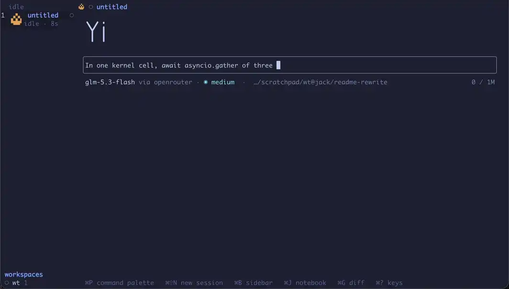

# Yi

A coding agent in one Rust binary. The model works inside a persistent Python kernel, where
subagents are function calls and plans are programs.



## Install

```bash
curl -fsSL https://raw.githubusercontent.com/jackmaxwil/yi/main/scripts/install.sh | bash
yi --version
```

The installer takes this machine's archive from the latest [release](https://github.com/jackmaxwil/yi/releases),
installs it only if its sha256 matches the release's `SHA256SUMS`, and puts `yi` in `~/.local/bin`
and its Python runtime and skills in `~/.yi`. Releases are built for macOS on Apple Silicon
(`aarch64-apple-darwin`) and signed with the owner's release key, which the installer checks when
`ssh-keygen` is on PATH. `| bash -s -- --dry-run` (or `--help`, which prints the key) changes nothing. By hand:

```bash
v=X.Y.Z t=aarch64-apple-darwin; base=https://github.com/jackmaxwil/yi/releases/download/v$v; a=yi-$v-$t.tar.gz
curl -fLO "$base/$a" -O "$base/$a.sig" -O "$base/SHA256SUMS" -O https://raw.githubusercontent.com/jackmaxwil/yi/main/allowed_signers
shasum -a 256 -c SHA256SUMS --ignore-missing && ssh-keygen -Y verify -f allowed_signers -I jackmaxwil-release -n yi-release -s "$a.sig" < "$a"
tar -xzf "$a" && "./yi-$v-$t/install.sh"
```

## Quick start

```bash
yi ask --model faux/faux-1 "hello"   # offline scripted model, no key: prints "faux: hello"
yi login openrouter                  # paste a key at the prompt
yi setup                             # pick the default model and permission mode
yi "what does this repo do?"         # one answer from the default model
yi                                   # the console: sessions on a rail, chat panes (--solo: one chat)
```

## Log in

| provider | command | how |
|---|---|---|
| OpenRouter, OpenAI, Google | `yi login openrouter`, `yi login openai`, `yi login google` | an API key, pasted at the prompt or piped on stdin |
| Cursor | `yi login cursor` | browser sign-in; `--no-browser` skips opening it |
| Kimi, Anthropic, OpenAI Codex | `yi login kimi`, `yi login anthropic`, `yi login openai-codex` | a profile you write first at `~/.yi/oauth/<provider>.json`: OAuth code, device code or API key ([templates](docs/examples)) |

Credentials go to `~/.yi/providers/tokens/<provider>.json` (mode 0600), never to the config file;
`ANTHROPIC_API_KEY`, `OPENAI_API_KEY`, `OPENROUTER_API_KEY` and `GEMINI_API_KEY` win when set.
`yi login --list` names the providers, and `yi logout [provider]` removes one, or all.

## Plugins and skills

| plugin | version | what it adds |
|---|---|---|
| `ripwire` | 0.6.5 | a code map: an edit's broken callers, a symbol's callers, the code a task touches; 16 skills |
| `chrome` | 155.0.8059.39 | Chrome for Testing's headless shell for the console's browser pane, when no Chrome is installed |

`yi plugin list`, `add <name>` (or `--all`), `remove <name>` and `sync` manage these pinned programs,
checked by sha256 and kept in `~/.yi/plugins`. A skill is a directory with a `SKILL.md` whose front
matter holds `name` and `description`, read from `.yi/skills`, `.agents/skills`, `.pi/skills` or
`.claude/skills` in the project, then in your home (only `~/.yi/skills` and the names `skills.global` lists). `$name` in a
message points the model at one.

## Configure

`~/.yi/config.json` is strict: an unknown key is an error that names it. Every key is in
[YI_DESIGN.md §17.1](docs/YI_DESIGN.md).

| key | default | meaning |
|---|---|---|
| `model`, `thinking` | none, `medium` | the session's `provider/id`; `off` to `max` reasoning effort |
| `models.summarizer`, `.advisor`, `.autoReview` | main model, off, off | compaction and titles; naming a model turns that reviewer on |
| `models.classifier` | off | the local [Laya](https://huggingface.co/convaiinnovations/laya) permission and skill classifier |
| `routing` | none | OpenRouter's `provider` object, sent as written |
| `permissions.mode`, `permissions.allow` | `auto`, none | `ask`, `auto` or `yolo`; calls that run unasked, e.g. `"bash cargo test*"` |
| `tui.pace` | 100 | streaming reveal speed in percent; 0 paints at once |
| `rlm.maxDepth` | 1 | how deep subagents nest, 1 to 3 |
| `kernel.prewarm`, `mcp.enabled`, `lanes.enabled` | true, false, true | boot the kernel at open; the MCP CLI; a worktree per root session |

| environment | for |
|---|---|
| `YI_PREFIX`, `YI_VERSION`, `YI_RELEASE_BASE` | install directory (`yi update` reads it too); the installer's release and where it reads it |
| `YI_KERNEL_VENV`, `YI_KERNEL_PYTHON`, `YI_BIN` | the kernel's venv and interpreter; the `yi` the kernel calls |
| `YI_TRACE`, `YI_CLAUDE_HOOKS`, `YI_CLAUDE_HOOKS_FILES` | a profiler trace directory; run Claude Code tool hooks, and from which plugin roots |
| `YI_LEVERS`, `YI_FIXED_IDS`, `YI_BLESS`, `YI_FAKE_RIPWIRE`, `YI_WARM`, `YI_REVIEW_MODEL`, `YI_ROUND_AUTHORS`, `YI_SIGNING_KEY`, `YI_ALLOWED_SIGNERS` | development: the `--eval` lever file, counted ids, golden rewrites, test fakes, the review bot, release signing |

| verbs (`yi --help`) | |
|---|---|
| `ask`, `rpc`, `acp`, `serve`, `console`, `tui` | one turn, printed; Pi JSON-RPC and ACP v2 on stdio; the session daemon; the workspace; the solo TUI |
| `plan`, `todo`, `why` | plan ops as the owner; the newest todo list; a line or todo traced to its goal |
| `sessions`, `stats`, `memory`, `fetch`, `catalog` | stored sessions; tools and tokens; memories; one URL through the wall; models |
| `undo`, `lanes`, `trust`, `gate`, `doctor`, `gc`, `debug` | undo a turn, worktrees, repository trust, policy, repair |
| `login`, `logout`, `setup`, `plugin`, `update`, `version`, `mcp` | setup, plugins, the release, MCP calls |

Flags include `--model <provider/id>`, `--system <text>`, `--thinking <level>`, `--json`, `--no-deltas`,
`--yolo`, `--auto`, `--confirm`, `--allow-write <dir>`, `--cwd <dir>`, `--here`, `--continue`,
`--session <id>`, `--schema <schema>` and `--deadline <secs>`; `yi --help` prints all of them.

## Plans

A plan is a goal and a graph of todos, written by the model with its `plan` tool or from a kernel cell
with `Plan.create`. A todo is `pending`, `running`, `blocked`, `done`, `failed` or `dropped`; one with a
contract (a command, a schema, an example, a jury of readers) closes only when its check passes, and a
third refused close blocks it on you. A delegated todo starts on a child once its `after` edges are
met, and every op goes to a digest-chained journal in `.yi/plans/`. `/plan` lists what is ready,
running and blocked, `/plantree` draws the tree, `yi plan report` times each todo, and
`yi why <file>:<line>` walks a line back to the words that asked for it. A goal
(`goal.create(objective, check=...)`) keeps a session going until its check passes.

## Subagents

A child is a session its parent starts from a kernel cell: a `reader` gets `read`, `grep` and three
turns, a `worker` also edits (and runs `bash` when named), a `root` is a full session. Walls (paths and
URLs it may not touch) and leases (tokens, time) only narrow down the tree. Children nest
`rlm.maxDepth` deep, eight per parent and sixteen live per family by default. A mailbox carries
inform, request, reply, progress, failure and cancel; a child's question goes to its parent and shows
on its card for you to answer. With `isolation="worktree"` a child works in its own git worktree, and
`rlm.merge_worktree` brings the work back unless its `check` fails.

```python
answers = await asyncio.gather(*(rlm.ask("Can this function panic? Quote the line.", [url]) for url in urls))
h = await rlm.run("Port the parser to the new token type", role="worker", isolation="worktree")
result = await h.result(timeout=420)
```

## Use Yi from programs

```console
$ yi ask --model faux/faux-1 --json --no-deltas hello | jq -r .type | tr '\n' ' '
agent_start turn_start message_start message_end message_start message_end turn_end agent_end final
$ yi ask --model faux/faux-1 --json --no-deltas hello | tail -1
{"type":"final","kind":"stop"}
```

`yi ask` exits 0 with an answer, 1 when the run failed, 2 when it was refused before starting (no
model, a bad flag), 3 when the answer misses `--schema`, and 4 when a headless run ends on a denied
tool call or a provider quota, so a CI step can gate on it:

```bash
if yi ask --model faux/faux-1 --schema '{"type":"object"}' "list the risks as JSON" > risks.json
then echo "risks.json written"; else echo "yi exited $?"; fi   # yi exited 3: the faux model answers no JSON
```

`git diff | yi ask -` reads the prompt from stdin; `--continue` resumes the newest session here and
`--session <id>` one from `yi sessions list`; `--model` and `--confirm`, `--auto` or `--yolo` pick the
model and permission mode per run. `yi acp` speaks ACP v2 on stdio for editors, and `yi serve` is the
daemon the console attaches to. With `{"mcp": {"enabled": true}}`, `yi mcp --json connect <server>`
and `yi mcp --json @<session> tools-call <name>` are one-shot MCP calls; `yi mcp help` lists the rest.

## SDK

A full SDK is coming. Today you can build on the `yi ask --json` event stream, ACP v2 over stdio
(`yi acp`) or the daemon's socket (`yi serve`), and the session files in `~/.yi/sessions/` (Pi's v4
session JSONL).

## Contributing

A private forge is the source of truth; this repository is a read-only mirror of its `main`.
Contributions arrive by invitation through the forge for now; GitHub pull request intake is planned,
not open ([CONTRIBUTING.md](CONTRIBUTING.md)). A change starts from an issue and merges from a branch
with `just check` green, a body that follows [the template](.github/PULL_REQUEST_TEMPLATE.md) and two
clean review bot rounds. Commits carry no attribution trailers.

## Built on

A few primitives (session, tool, kernel, URL, child, todo, plan, contract, lane) compose every feature
([YI_DESIGN.md §3](docs/YI_DESIGN.md#3-primitives-and-composition)); every cut of model-facing text
names what it kept, the cap and the call that gets the rest. `auto` mode sandboxes commands with macOS
Seatbelt and asks before anything destructive; credential stores and `.git` stay denied even in `yolo`.
A session is an append-only Pi v4 JSONL log you can branch, rewind and resume after a crash.

## Develop and license

`just dev` builds and starts `yi`; `just check` runs fmt, clippy, the guardrails and the tests;
`just build-dist` makes the release build. [YI_DESIGN.md](docs/YI_DESIGN.md) is the law and
[ARCHITECTURE.md](docs/ARCHITECTURE.md) the map. Apache License 2.0, in `LICENSE`; the copyright
notice (Jack Mazac and AiBridge LLC) is in `NOTICE`. `vendor/` keeps its upstream licenses.
